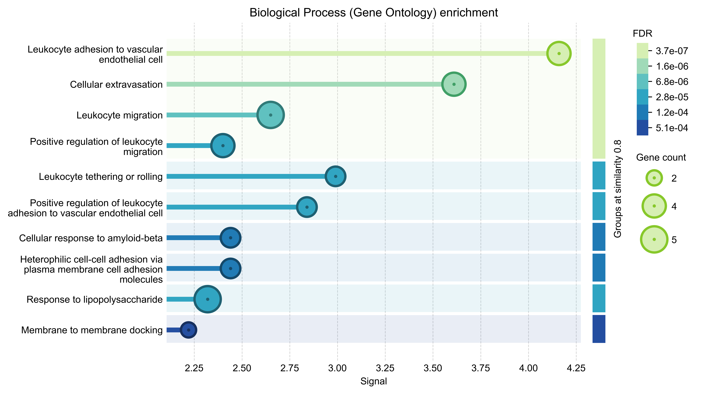

Endothelial–Immune Protein Association Network Analysis

Project Overview

This exploratory systems biology project investigates functional associations among six human proteins involved in endothelial activation, leukocyte adhesion, inflammatory signalling and vascular nitric oxide regulation.

The analysis was performed using the STRING database to examine network connectivity and identify enriched biological processes and pathways.

Proteins investigated: ICAM1, VCAM1, SELE, IL6, TNF and NOS3.

Research Aim

To explore how proteins associated with endothelial–immune communication are functionally connected and identify biological pathways relevant to vascular inflammation and metabolic stress.

Methods

Database: STRING protein association network database

Organism: Homo sapiens

Input: Six manually selected proteins

Analysis: Protein association network construction and functional enrichment analysis

Annotations: Gene Ontology Biological Process and KEGG pathways

Statistical assessment: STRING PPI enrichment and false discovery rate (FDR)-adjusted pathway enrichment

Protein Association Network

Network Statistics

Metric

Result

Number of nodes

6

Number of edges

15

Expected edges

3

Average node degree

5

Average local clustering coefficient

1.0

PPI enrichment p-value

2.71 × 10⁻⁶

The six selected proteins form a densely connected association network, with more associations than expected under STRING's reference model.

Functional Enrichment Analysis

Selected enriched annotations include:

Biological process or pathway

FDR

Leukocyte adhesion to vascular endothelial cell

3.72 × 10⁻⁷

Cellular extravasation

1.81 × 10⁻⁶

Leukocyte migration

5.33 × 10⁻⁶

AGE–RAGE signalling pathway in diabetic complications

5.07 × 10⁻¹²

Lipid and atherosclerosis

1.29 × 10⁻¹⁰

TNF signalling pathway

3.10 × 10⁻⁹

Biological Interpretation

The enrichment results highlight functional relationships among endothelial adhesion molecules, inflammatory mediators and vascular signalling proteins.

The representation of AGE–RAGE and atherosclerosis-related pathways provides a biologically relevant connection to metabolic stress and vascular inflammation.

These findings illustrate how network biology can be used to organise existing molecular knowledge and generate hypotheses about endothelial-immune communication.

Limitations

This is an exploratory, database-driven analysis rather than an experimental investigation.

The six proteins were selected because of their known biological relationships, so the observed network enrichment is not an independent discovery.

STRING associations do not necessarily represent direct physical protein interactions. Likewise, pathway enrichment does not establish pathway activation, causality or differential protein abundance.

Repository Contents

network visualisation and Gene Ontology enrichment plot

 STRING interaction and enrichment results

Relevance to Future Research

protein association networks, functional enrichment analysis, statistical interpretation and systems biology, with particular relevance to research investigating endothelial–immune communication and metabolic stress.
